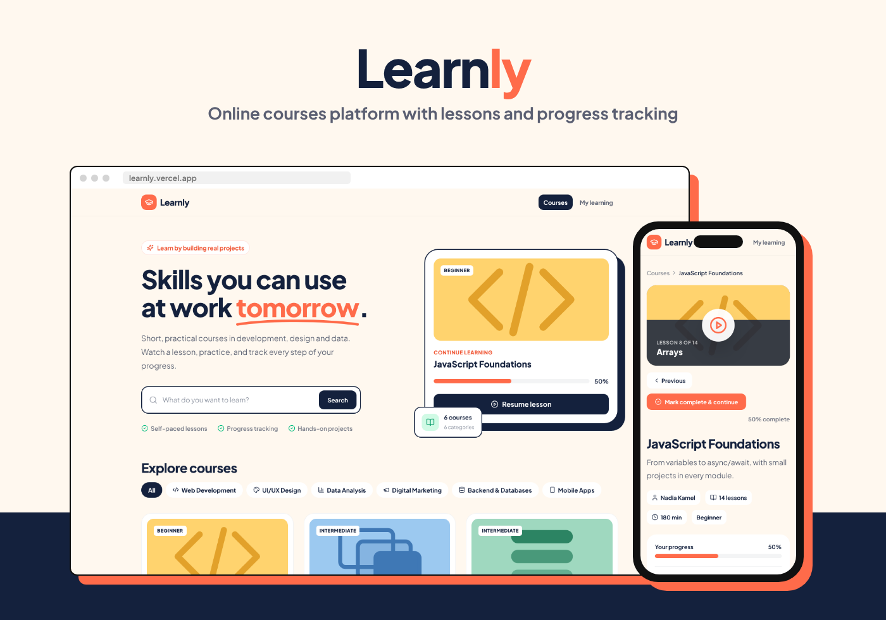
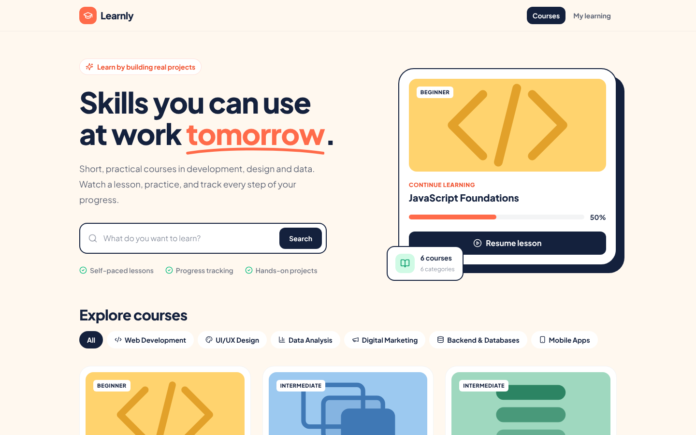
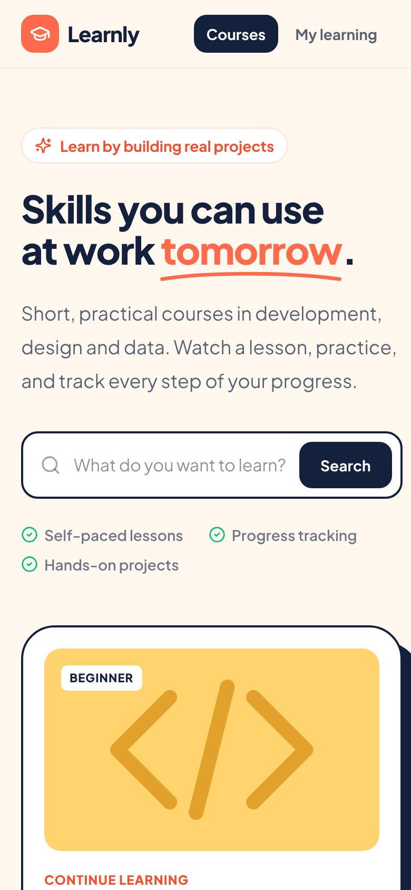
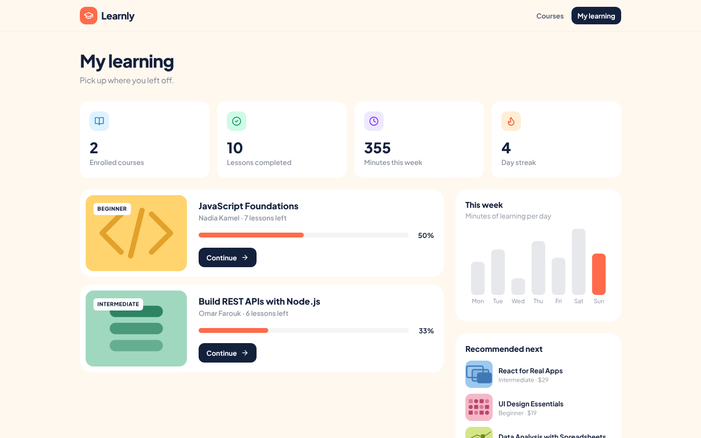
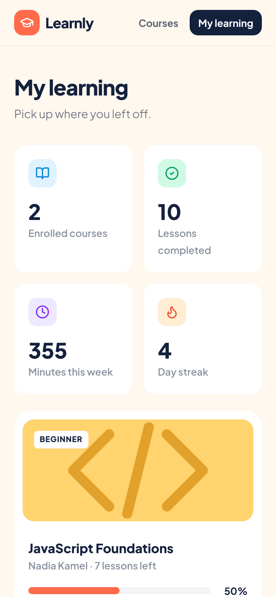
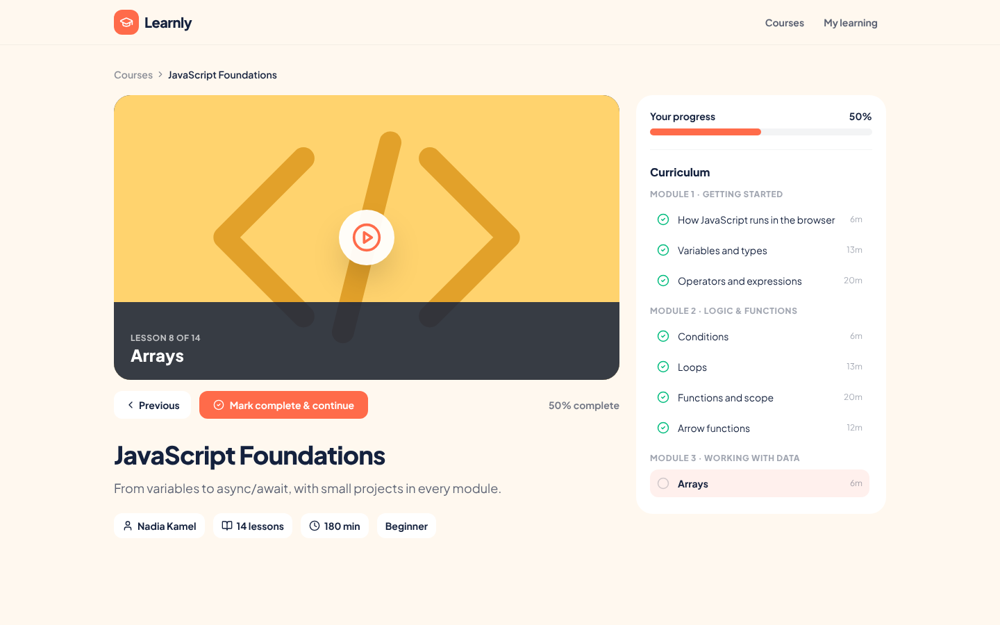
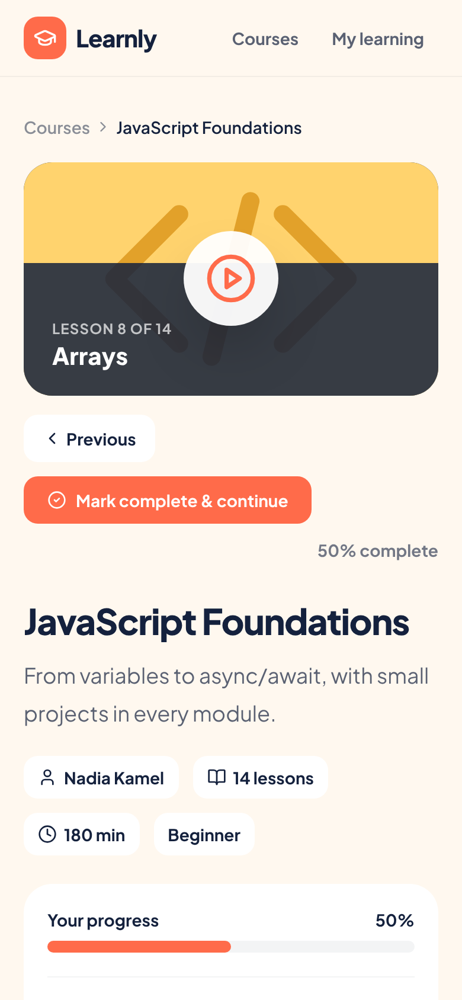

# Learnly

An online learning experience that takes users from course discovery to enrollment, lesson completion, and progress tracking.



> Learnly is an independent portfolio concept. The brand, courses, instructors, and learner data are fictional.

## What it demonstrates

- Product-oriented frontend development across a complete learner journey
- Search, filtering, enrollment, lesson navigation, and progress state
- Responsive interfaces for desktop and mobile
- Persistent browser state without requiring a backend for the demo
- Data visualization for learner activity and course progress

## Core features

### Course discovery

- Searchable course catalog
- Category-based filtering across six subject areas
- Custom SVG artwork for course covers
- Responsive course cards with instructor, rating, level, and duration details

### Course learning flow

- Detailed course pages with modular curricula
- Enrollment flow and lesson player
- Mark-as-complete and continue-learning actions
- Per-course completion progress persisted in `localStorage`

### My Learning dashboard

- Overview of enrolled courses and completion percentages
- Weekly learning activity displayed with Recharts
- Continue-learning shortcuts and course recommendations

## Tech stack

- React 18
- Vite 6
- Tailwind CSS 4
- React Router 6
- Recharts
- Lucide React
- Browser `localStorage`

## Application routes

| Route | Purpose |
| --- | --- |
| `/` | Course catalog and discovery |
| `/course/:id` | Course details, curriculum, and lesson flow |
| `/my-learning` | Enrolled courses, progress, and activity |

## Run locally

```bash
npm install
npm run dev
```

To verify the production build:

```bash
npm run build
npm run preview
```

## Screenshots

| Experience | Desktop | Mobile |
| --- | --- | --- |
| Course catalog |  |  |
| My Learning |  |  |
| Course details |  |  |

## Current scope

This repository focuses on the frontend product experience. Enrollment, progress, and activity are simulated and stored in the browser. A production release would connect these flows to authenticated APIs, a learning-content service, and a real payment provider.

## Author

**Mohamed Ashraf**

